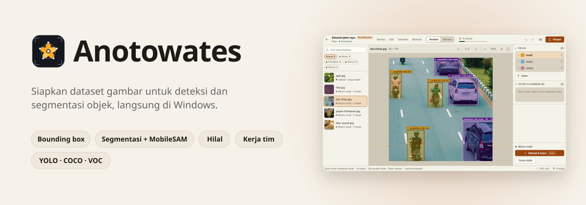
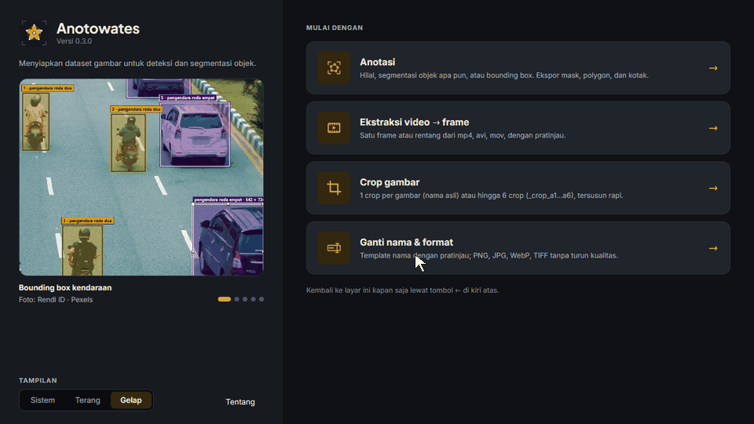
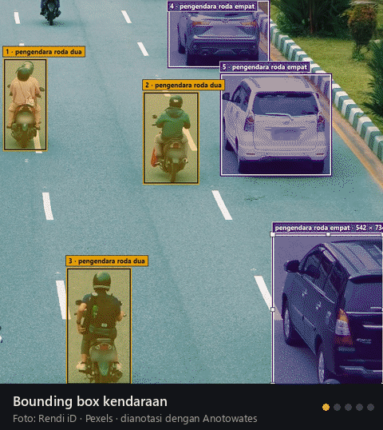
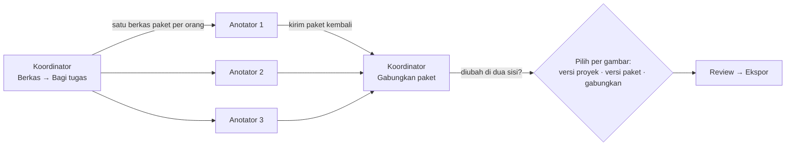

<div align="center">

<picture>
  <source media="(prefers-color-scheme: dark)" srcset="media/hero-dark.svg">
  
</picture>

[](https://github.com/BKrisnamurti-tech/AnotoWates/releases/latest)
[](https://github.com/BKrisnamurti-tech/AnotoWates/releases)


### [⬇ Unduh Anotowates untuk Windows](https://github.com/BKrisnamurti-tech/AnotoWates/releases/latest)

Ekstrak zip, buka `Anotowates.exe`. Tidak perlu memasang Python atau apa pun.

</div>

---

**Anotowates** menyiapkan dataset gambar untuk melatih model deteksi dan segmentasi objek: tandai objek, periksa hasilnya, lalu ekspor ke format yang dipakai YOLO, Detectron, MMDetection, dan sejenisnya. Semuanya berjalan di komputer Anda; gambar tidak pernah diunggah ke mana pun.

Nama berasal dari bahasa Jawa: *anoto* (menandai) dan *wates* (batas).

<p align="center"></p>

## Yang bisa dilakukan

| | |
|---|---|
| **Bounding box** | Tarik kotak, ganti kelas dengan angka 1–9, geser dan ubah ukuran dengan titik sudut. |
| **Segmentasi** | Polygon titik demi titik dengan tepi dirapikan otomatis, kuas tambah/kurangi, kotak miring, dan **klik ajaib MobileSAM**: satu klik, objeknya tersegmentasi. |
| **Hilal** | Penanda bulan sabit muda dengan dua cusp dan batas lengkung, khusus untuk dataset rukyat. |
| **Review** | Jumlah gambar per status dan validasi seluruh dataset sebelum ekspor: objek, kelas, mask, dan apakah gambar sumbernya berubah. |
| **Ekspor** | YOLO, COCO, Pascal VOC, LabelMe, dan mask PNG (biner atau per kelas), dengan pembagian train/validasi. |
| **Proyek besar** | Puluhan ribu gambar dalam satu berkas `.anoproj`; setiap editan tersimpan otomatis dalam sekejap. |
| **Gambar dipindah** | *Cocokkan folder gambar* menemukan gambar lewat isinya, walau nama dan foldernya sudah berubah. |
| **Alat berkas** | Ekstraksi frame dari video, crop massal hingga 6 area per gambar, dan ganti nama & format dengan pratinjau. |

<table>
<tr>
<td width="50%"></td>
<td>

### Contoh hasil

Foto-foto ini dianotasi dengan Anotowates:

- **Kendaraan:** bounding box per kelas.
- **Papan himbauan:** kotak miring.
- **Apel:** segmentasi polygon.
- **Telur puyuh:** banyak objek satu kelas.
- **Hilal:** batas bulan sabit.

<sub>Foto dari Pexels (lisensi Pexels); nama fotografer tertera di tiap foto. Pelat nomor kendaraan disamarkan.</sub>

</td>
</tr>
</table>

## Kerja tim tanpa server

Satu proyek dibagi ke beberapa anotator lewat berkas, lalu digabungkan kembali. Tidak perlu server, akun, atau internet.



- Gambarnya tidak ikut di paket, jadi berkasnya kecil. Anotator menunjuk folder gambarnya sendiri, dan gambar dikenali lewat isinya.
- Paket boleh dikirim berkali-kali selama dikerjakan; yang sudah diambil tidak ditanyakan lagi.
- Kelas baru buatan anotator ikut ditambahkan; kelas yang diganti nama koordinator tetap dikenali.

## Syarat dan pemasangan

- **Windows 10 atau 11, 64-bit.**
- **Microsoft Edge WebView2 Runtime**, sudah ada di Windows 11 dan Windows 10 yang diperbarui. Bila belum ada, [unduh gratis dari Microsoft](https://developer.microsoft.com/microsoft-edge/webview2/); tanpanya Anotowates memakai tampilan klasik.
- Sekitar 250 MB ruang disk. Folder aplikasi boleh dipindah atau dibawa dengan flashdisk.

**Pastikan unduhan asli.** Di halaman rilis ada `SHA256SUMS.txt`. Di PowerShell, jalankan perintah di bawah, lalu bandingkan hasilnya dengan baris zip di berkas itu:

```powershell
Get-FileHash .\Anotowates-0.3.0-windows-x64-portable.zip
```

<details>
<summary><b>Windows menampilkan "Windows protected your PC"</b></summary>

`Anotowates.exe` belum ditandatangani secara digital, jadi SmartScreen memperingatkan aplikasi yang belum dikenalnya. Bila zip diunduh dari halaman rilis ini dan checksum-nya cocok, pilih **More info → Run anyway**. Unduh hanya dari halaman ini, bukan dari situs lain.
</details>

## Pintasan keyboard

<details>
<summary><b>Tampilkan semua pintasan</b> (di aplikasi: tekan <kbd>?</kbd>)</summary>

| Tombol | Fungsi |
|---|---|
| <kbd>1</kbd>–<kbd>9</kbd> | Pilih kelas (juga mengganti kelas objek terpilih) |
| <kbd>Enter</kbd> | Selesai & lanjut ke gambar berikutnya |
| <kbd>N</kbd> | Tandai gambar tanpa objek |
| <kbd>Tab</kbd> / <kbd>Shift</kbd>+<kbd>Tab</kbd> | Objek berikutnya / sebelumnya |
| <kbd>Alt</kbd>+panah | Geser objek 1 px (<kbd>Shift</kbd> = 10 px) |
| <kbd>Delete</kbd> | Hapus objek terpilih |
| <kbd>Ctrl</kbd>+<kbd>Z</kbd> / <kbd>Ctrl</kbd>+<kbd>Y</kbd> | Batalkan / ulangi |
| <kbd>W</kbd> · <kbd>T</kbd> · <kbd>Q</kbd> · <kbd>V</kbd> · <kbd>A</kbd>/<kbd>K</kbd> | Segmentasi: klik ajaib · polygon · kotak miring · pilih · kuas |
| Roda mouse · <kbd>Spasi</kbd>+tarik | Zoom · geser tampilan |
| <kbd>F</kbd> · <kbd>Z</kbd> · <kbd>O</kbd> | Pas di layar · zoom ke objek · tampilkan/sembunyikan anotasi |
| <kbd>PageDown</kbd> / <kbd>PageUp</kbd> | Gambar berikutnya / sebelumnya |
| <kbd>F11</kbd> | Mode fokus |
| <kbd>Ctrl</kbd>+<kbd>S</kbd> · <kbd>Ctrl</kbd>+<kbd>O</kbd> · <kbd>Ctrl</kbd>+<kbd>E</kbd> | Simpan · impor gambar · ekspor dataset |
</details>

## Pertanyaan umum

<details>
<summary><b>Apakah butuh internet?</b></summary>

Tidak. Internet hanya dipakai sekali bila Anda memilih mengunduh model klik ajaib (MobileSAM, ±40 MB), dan aplikasi selalu bertanya dulu.
</details>

<details>
<summary><b>Di mana data saya disimpan?</b></summary>

Proyek (`.anoproj`) dan hasil ekspor disimpan di folder yang Anda pilih. Pengaturan, model MobileSAM, dan catatan galat ada di folder `data` di sebelah `Anotowates.exe`. Gambar Anda tidak pernah disalin ke folder aplikasi atau dikirim ke mana pun.
</details>

<details>
<summary><b>Bisakah membuka proyek dari versi lama?</b></summary>

Bisa. Proyek dari 0.2.0 terbuka di 0.3.0. Sebaliknya tidak: proyek yang sudah disimpan oleh 0.3.0 tidak bisa dibuka lagi oleh 0.2.0, jadi perbarui aplikasi di semua komputer tim.
</details>

<details>
<summary><b>Apakah gratis?</b></summary>

Gratis untuk pemakaian pribadi dan pendidikan. Pemakaian komersial perlu izin tertulis. Lihat [LICENSE.md](LICENSE.md).
</details>

## Melaporkan masalah

Buka [Issues](https://github.com/BKrisnamurti-tech/AnotoWates/issues). Sertakan versi aplikasi (**Bantuan → Tentang**) dan berkas `data\logs\anotowates.log` bila ada; isinya hanya galat, bukan isi proyek Anda.

## Perubahan dan lisensi

- Perubahan per versi: [CHANGELOG.md](CHANGELOG.md)
- Lisensi pengguna: [LICENSE.md](LICENSE.md)
- Komponen pihak ketiga: [THIRD_PARTY_NOTICES.md](THIRD_PARTY_NOTICES.md)

<div align="center">

**Dibuat oleh BKrisnamurti-tech**

[](https://trakteer.id/Jiakai)

</div>
